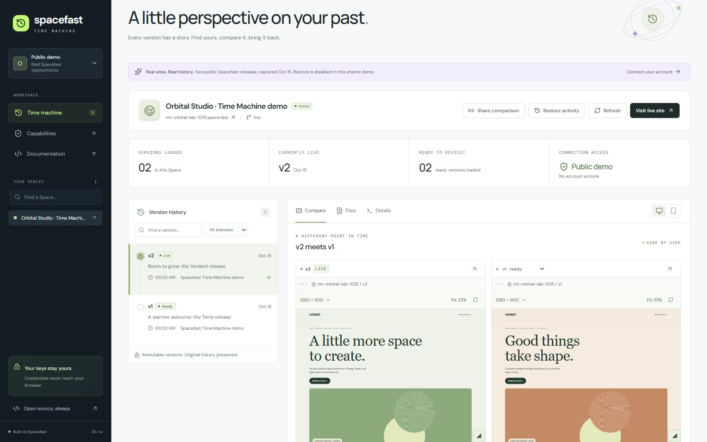
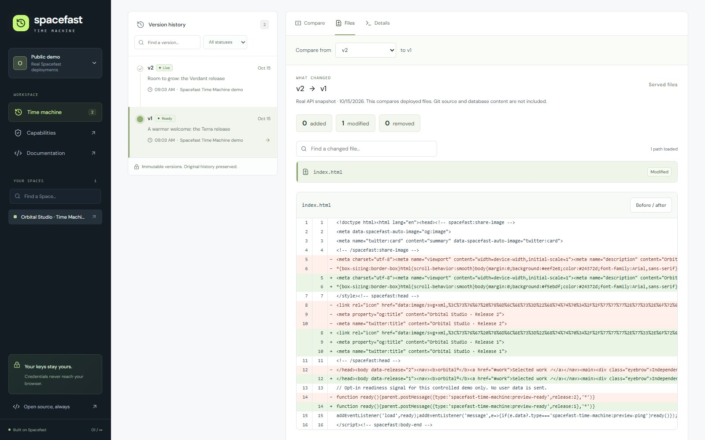

# Spacefast Time Machine

[](https://github.com/Cube3868/spacefast-time-machine/actions/workflows/ci.yml)

A considered way to look back. Explore your Spacefast deployment history, compare two immutable versions, and safely promote an earlier ready version to live.

[**Try the live demo**](https://space-xx8uckgsp.space.fast/?demo=1) · [**Open the app**](https://space-xx8uckgsp.space.fast/) · [**Watch the walkthrough**](https://space-xx8uckgsp.space.fast/walkthrough/)



The public demo uses two actual deployed releases and disables restore. Connect your own account to browse permitted Spaces, inspect version history, and use a typed confirmation for an eligible restore. Spacefast may require a separate approval; success appears only after the operation and live version are verified.



Built for **Spacefast hosting from the first deployment**: a React and TypeScript frontend, Spacefast Functions, and the database provided by the Functions `env.DB` binding. MIT licensed. No alternate hosting service or external database is required.

## Hosting and source

- Deployment: https://space-xx8uckgsp.space.fast/
- Try real deployments without signing in: https://space-xx8uckgsp.space.fast/?demo=1
- Source browser: https://space-xx8uckgsp.space.fast/source/
- GitHub repository: https://github.com/Cube3868/spacefast-time-machine
- Spacefast-hosted Git repository: https://space-xx8uckgsp.space.fast/source.git

The source browser and HTTP-cloneable Git repository are packaged on Spacefast alongside the app. They contain committed source only; no credentials, CLI state, dependencies, or test artifacts are published. No GitHub account is required to obtain the source. A source archive is also available under `/source/spacefast-time-machine.tar.gz`.

```sh
git clone https://github.com/Cube3868/spacefast-time-machine.git
cd spacefast-time-machine
npm ci
npm run dev
```

The GitHub source includes the MIT license, real deployment screenshots, and setup and API documentation. The walkthrough is a captioned recording of the real public demo, edited by Claude; it does not depict a simulated restore as a live operation.

Use `git -c http.maxRequests=1 clone https://space-xx8uckgsp.space.fast/source.git` to avoid intermittent parallel-download errors. A complete Git bundle is also available at `/source/spacefast-time-machine.bundle`: download it and run `git clone -b main spacefast-time-machine.bundle spacefast-time-machine` if HTTP cloning fails.

The Space is claimed and the app, source browser, and cloneable repository are public. Runtime and database health are verified through the deployed Functions endpoint. See [deployment verification](docs/DEPLOYMENT.md).

## Features

- OAuth authorization code flow with S256 PKCE. No API key input form.
- Read access by default; optional publish access for restore.
- Paginated Space search and version history, including real lifecycle status, provenance where available, immutable links, and the current live pointer.
- Selectable timeline, status filters, search, desktop/mobile side-by-side previews, and deployment metadata.
- Resizable preview viewports with a drag handle, keyboard controls, exact width/height inputs, fit scaling, and reset.
- A Files view with real added/modified/removed paths, paginated search, unified text diffs and before/after text. Binary, oversized and missing content has an explicit unavailable reason. This compares served files, not Git source.
- Shareable links preserve the exact Space, versions and view, including historical versions outside the first page. A private comparison survives OAuth sign-in and still requires access to both versions; the link grants no permission.
- A per-account restore activity log records attempted version changes, pending/failed outcomes and live verification. Records persist across disconnect. External publishes are not included, and completion times absent from older session records remain unavailable.
- Immutable-link previews by default, optional documented version-only sessions for private versions, and explicit fallback when embedding is unavailable.
- Explicit, expiring, session-bound restore confirmations, a fresh live-version check, single-use submission, an idempotency key, and asynchronous operation/live-pointer verification.
- A public demo with two actual Spacefast deployments. Its history is an explicitly dated CLI snapshot, both frames use real immutable URLs, and restore is disabled. Controlled demo pages report readiness with source/origin validation; arbitrary account pages are never called verified solely because an iframe loaded.
- Responsive navigation, native modal focus management, reduced-motion support, and automated WCAG AA checks.

## Public demo

The public demo Space is `spc_ee81cba49aa7483181d752847a250bf9` at https://tm-orbital-lab-1015.space.fast/. It contains disposable content only. The source is in `examples/orbital-studio/render.mjs`; `scripts/publish-demo.mjs` publishes it with the official CLI and records only public version metadata in `src/demo.json`. The original setup uses the original team and slug: change those before using this helper for a new account. It never mutates an existing non-demo Space.

The real OAuth connection, account history, both deployed preview releases, and a full **v2 → v1 → v2** restore round trip have been verified. The round trip used a separate disposable Space and the app's own confirmation flow. Spacefast's human approval was completed for the rollback, then the app continued the exact approved promotion with its encrypted continuation capability and original idempotency key. The actual live website and official CLI live pointer were checked after both changes. See [deployment verification](docs/DEPLOYMENT.md).

## Run locally

Use Node.js 24.13 or later (the focused backend tests use Node's built-in SQLite module) and Git. The production worker uses Web APIs, not Node's SQLite or filesystem.

```sh
npm ci
npm run dev
```

Open `http://127.0.0.1:5173` and choose **Try live demo**. Local preview deliberately has no production account credentials or database binding. Real account connection requires the HTTPS Spacefast deployment and a claimed hosting Space. A localhost page cannot silently act as the deployed app.

## Build, test, and publish

```sh
npm test
npm run build
```

For browser validation, start `npm run dev` in another terminal, then:

```sh
npm run test:e2e
```

The browser check uses a separate headless Chrome session through Playwright CLI. It validates the real public demo UI, filters, comparisons, failed states, permission affordances, dialogs, mobile navigation and horizontal layout, then runs axe on welcome, demo, details and dialogs. Screenshots go to ignored `artifacts/`. It does not touch a personal browser session. Chrome must be installed; Playwright CLI can install a browser when needed.

To test account-connected UI states using test-only intercepted API responses:

```sh
npx playwright-cli -s=spacefast-tm run-code --filename=scripts/qa-account.js
npx playwright-cli -s=spacefast-tm run-code --filename=scripts/qa-approval.js
npx playwright-cli -s=spacefast-tm run-code --filename=scripts/qa-comparison.js
npx playwright-cli -s=spacefast-tm run-code --filename=scripts/qa-linked-account.js
```

The unit tests execute server SQL against an in-memory D1-shaped SQLite adapter and intercept provider calls. They cover actual request/response and security behavior, including confirming only one promotion, refusing changed live state, and withholding success until verified. They do **not** establish a live account authorization or promote a real user's Space.

Install and authenticate the official Spacefast CLI:

```sh
npm install -g spacefast@0.5.0
sf login
sf whoami
```

For a new anonymous deployment, finish its claim in the browser. The original deployment has already been claimed:

```sh
sf spaces claim --team abneybriar-team --wait
```

After claiming, allow public viewing of the app, source, and immutable versions:

```sh
sf share grant --to public --role viewer --path '/**' --target all-versions --name 'Open source Time Machine' --wait
sf share grant --to public --role viewer --path '/**' --target live --name 'Public Time Machine app' --wait
```

Publish future changes with the official CLI after committing them:

```sh
npm run build
npm run deploy
```

`npm run deploy` invokes `sf publish --prebuilt --source-type direct-upload --wait` on a fresh staging copy of `dist`, preserves the saved Space link, and writes a sanitized receipt to ignored `artifacts/deployment.json`. Staging prevents the official compiler's generated files from causing duplicate-manifest paths on a subsequent publish. On Windows it invokes the installed CLI JavaScript entry with Node and no shell interpolation. If the global installation is elsewhere, set `SF_CLI_ENTRY` to its `dist/cli.js`. On other platforms `sf` is resolved normally. `node scripts/deploy.mjs --dry-run` validates packaging without uploading.

The generated source repository reflects **HEAD**. Commit your changes before building a public release. `dist/sf.jsonc` drops build settings because the directory is already built. The production artifact includes the official `functions/` router and its helper module. It does not contain the original source tree except in the explicitly published source repository.

Register your own public OAuth client after the app has a stable HTTPS origin:

```sh
node scripts/register-oauth.mjs https://your-space.space.fast
sf env set TM_OAUTH_CLIENT_ID THE_PUBLIC_CLIENT_ID --no-secret
```

The registration helper uses Spacefast's advertised dynamic registration endpoint with `token_endpoint_auth_method: none`; it does not request or save a client secret. It prints the public client ID and exact setup command. The server fails closed with an unavailable message if `TM_OAUTH_CLIENT_ID` is not configured. Deploy the code after configuring the variable. Changing the origin requires a new registration with the corresponding callback URI.

## Account connection and security

The official [authentication documentation](https://spacefast.com/docs/api/authentication/) specifies authorization code for people. The live [OAuth authorization-server metadata](https://api.spacefast.com/.well-known/oauth-authorization-server) advertises S256 PKCE, authorization code, `token_endpoint_auth_method: none`, and dynamic registration at `/v1/auth/oauth2/register`. The original deployment received HTTP 201 from that endpoint with a public client ID and no client secret. Its ID is configured server-side in `TM_OAUTH_CLIENT_ID`. Public client metadata remains available at `/oauth/client-metadata.json` for inspection. This app does not invent a client ID, reuse the CLI's device client, or ask for an account API key in JavaScript.

Although Spacefast also advertises metadata-document client IDs, a live authorization attempt rejected the app's publicly reachable metadata URL with `invalid_client` and a metadata-fetch error. The app therefore uses a registered public client, not that unverified mechanism.

Default scopes are `spaces:read teams:read versions:download`. Preview sessions require file-link authority; they are read capabilities. Optional restore adds `publish:write`, which grants more than a single promotion; the provider consent screen remains the authority and each app restore still requires confirmation. If Spacefast refuses a capability for the account, the app shows it as unavailable.

The backend generates state and a PKCE verifier and binds them to an opaque, random 256-bit `__Host-tm` cookie. Cookies are Secure, HttpOnly, SameSite=Lax, host-only, and rotated after successful authorization. The database stores a hash of the session ID and an AES-GCM-encrypted payload. The encryption key is derived from the independent opaque cookie; the database does not store that key. A database dump alone cannot decrypt the tokens. The browser receives no account token, API key, refresh token, or PKCE verifier. Browser JavaScript never reads the session cookie.

The default preview uses the API's immutable version URL. For private versions the user can request a documented short-lived, single-version preview proof, passed to an iframe as the API requires. That proof is not an account API key. Real frames run on a different origin, disallow top navigation and popups, and use `referrerpolicy="no-referrer"`. A frame that does not load gets an explicit message after twelve seconds. Provider sessions and browser policies can limit framing; direct version links and an alternate preview mode remain available.

There is no refresh-token grant. Sessions expire at the access token deadline or after eight hours, whichever is earlier; reconnect when needed. Disconnect deletes local server-side credentials and unsubmitted confirmations and expires the cookie. Unresolved restore records and per-Space guards remain until a terminal result is verified. A hashed stable account identity allows recovery after reconnect without exposing another account’s attempts. It does not claim to revoke the underlying provider token; provider expiry still applies. Expired rows are pruned on subsequent sign-ins. As with any server application, protect the host, database, runtime logs, and HTTPS session cookies.

Mutation endpoints enforce the request Origin and fetch-site. Restore tickets are tied to the session and version, expire in two minutes, require the exact Space slug, and are consumed once with an atomic conditional update in the app database. The account itself authorizes all upstream requests. No shared operator key is used to access other people's accounts. Output projections omit configuration, pending upload URLs, identity boot tokens, and other unneeded fields. Errors do not relay credential-bearing provider bodies.

## Supported APIs and honest limits

The app was based on the official docs and live OpenAPI document (`info.version: 0.6.0` at inspection). See [the recorded contract](docs/api-contract.json) and [discovery snapshot](docs/oauth-discovery.json).

| Purpose                       | Documented route                                                                              |
| ----------------------------- | --------------------------------------------------------------------------------------------- |
| Account identity              | `GET /v1/me`                                                                                  |
| Space list and search         | `GET /v1/spaces?limit=30&query=…&cursor=…`                                                    |
| Space status and live pointer | `GET /v1/spaces/{spaceId}`                                                                    |
| Version history               | `GET /v1/spaces/{spaceId}/versions?limit=40&cursor=…`                                         |
| Target readiness              | `GET /v1/spaces/{spaceId}/versions/{versionId}`                                               |
| Frame a single version        | `POST /v1/spaces/{spaceId}/versions/{versionId}/preview-session`                              |
| Restore via promotion         | `POST /v1/spaces/{spaceId}/versions/{versionId}/promote?async=1` with `{ "channel": "live" }` |
| Async result                  | `GET /v1/operations/{operationId}`                                                            |

Every request uses `https://api.spacefast.com` from the server; no caller-selectable API host exists.

| Capability                                                           | Availability                                                                                                                                                                                    |
| -------------------------------------------------------------------- | ----------------------------------------------------------------------------------------------------------------------------------------------------------------------------------------------- |
| Version history, lifecycle status, immutable links                   | Supported, subject to permission and actual data                                                                                                                                                |
| Preview                                                              | Supported through documented preview sessions; subject to readiness, download authority, site policies, and browser cookie support                                                              |
| Rollback/promotion                                                   | Supported for a ready version on `live`, subject to publish authority and confirmation                                                                                                          |
| Atomic compare-and-swap on promotion                                 | **Unavailable.** The documented promote body has only `channel`. This app checks immediately before submitting, but another publisher can race the API request. The confirmation explains this. |
| Additional deployment channels                                       | **Unavailable.** The current promote API explicitly rejects channels other than `live`.                                                                                                         |
| Historical database content                                          | **Unavailable.** A version is not a database backup. Runtime code or migrations can change when a version is promoted.                                                                          |
| Missing commit attribution, missing immutable URL, non-ready preview | Explicitly marked **Unavailable**; never synthesized                                                                                                                                            |
| Account APIs from an unclaimed hosting Space                         | **Unavailable** under Spacefast's documented outbound-fetch restrictions                                                                                                                        |

Deployment status and serving state are separate: `status` is the operation lifecycle; `disabled` means serving is disabled. The UI shows that distinction. Metrics count loaded pages only, not invented global totals. A submitted restore is never called successful until the operation (if present) succeeds and the Space's live pointer matches the target. On a timeout or ambiguous failure, the app preserves a ticket and blocks a second restore while status is checked. The guard is acquired atomically in the server database for the entire Space, including across tabs and sessions. Reload and reconnect recover unresolved tickets. Prepared confirmations are session-bound; a reconnected owner can check a submitted attempt but cannot reuse a prior confirmation. The guard only serializes this app’s attempts, not external publishers. Spacefast approval requirements are reported explicitly and never treated as success.

## Source layout

`src/Changes.tsx` uses the documented `GET /v1/spaces/{spaceId}/versions/compare` through the authenticated server proxy. Text requires `versions:download`; no signed download links or account tokens are sent to the browser. Its code renderer escapes file text rather than executing HTML. The diff engine is loaded only when the Files view opens. `scripts/snapshot-comparison.mjs` records both directions of the public demo through the official CLI; the demo labels that data as a dated snapshot.

`src/RestoreActivity.tsx` reads app-owned activity from the server database. Each request checks current Space access and filters by the authenticated account's stable owner identity. Activity contains Space/version IDs, outcomes and timestamps, with no credentials or continuation capabilities. Existing records for the current session can be recovered without inventing a historical completion timestamp.

Provider approvals use the documented `requiresAction` envelope and `POST /v1/actions/resume`. The continuation secret is encrypted in the server database using the current session key and never returned to the browser. The server respects the provider's polling interval and serializes resume calls. When resume returns an approved receipt, the app persists that phase and continues the **same** promotion URL, body, principal and idempotency key with `X-Spacefast-Continuation-Token`. This follows the continuation handshake described in Spacefast's [official CLI reference](https://www.npmjs.com/package/spacefast) and [API-key API contract](https://spacefast.com/docs/api/reference/account/createapikey/); its use for promotion was verified against the live service. It rechecks the live version and target readiness after approval, atomically claims execution, and never treats approval as deployment success. A lost promotion reply remains guarded rather than creating a new attempt.

Reload recovers the current Space's action; another Space's unresolved action does not block it. Keep the same session until approval finishes: disconnect removes its encrypted continuation, while preserving the unresolved guard. If continuation is refused or its outcome is uncertain, the app reports that condition instead of bypassing approval or reporting success.

```text
src/                 React client, responsive styles, public demo snapshot
examples/            Source for the real, disposable Orbital Studio deployments
functions/_app.ts    OAuth, encrypted sessions, provider adapter, restore protocol
functions/api/       Spacefast Functions file-router entry
functions/oauth/     Public OAuth client metadata route
tests/               Focused backend/security tests
scripts/             Packaging, safe CLI deployment, headless UI checks
docs/                Documented API contract, discovery, deployment checkpoint
```

Useful official references: [documentation](https://spacefast.com/docs/), [API overview](https://spacefast.com/docs/api/), [API reference](https://spacefast.com/docs/api/reference/), [Functions](https://spacefast.com/docs/functions/), [CLI](https://spacefast.com/docs/cli/), [versions and live channel](https://spacefast.com/docs/versions/).

## License and contributions

MIT. Copy, modify, and self-host on your own Spacefast Space. Use a branch for changes, add focused tests for security-sensitive behavior, run the build and browser checks, and verify the deployed runtime. This is an independent open-source application, not an official Spacefast product.
